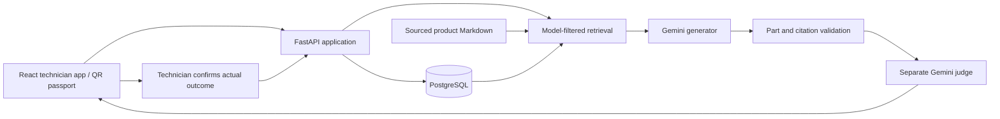

> Current Calgary v3 architecture: see [V3_CALGARY.md](V3_CALGARY.md). Earlier sections below describe the prototype and may be superseded, especially roles, approval, QR privacy and model costs.

# Architecture and extension plan

## Current application



One small deployable application with distinct modules is intentional for the two-person capstone. It avoids the expense and operational burden of microservices while leaving boundaries that can be extracted when workloads justify it.

- **Identity and history:** `server/database.py` separates individual Asset identity from ServiceRequest, Passport Event, KnowledgeCase and AIRun. Every event/request belongs to a physical asset and workspace. An equipment model is not an asset identifier.
- **Workflow/API:** `server/main.py` enforces workspace ownership, asset binding, request version checks and report idempotency. Report finalization and creation of future knowledge happen in one PostgreSQL transaction.
- **Knowledge:** `knowledge/products/<manufacturer>/<model>/` holds product and parts Markdown with source URLs, printed revisions, extraction scope and dates. The database stores technician cases with their original outcome and provenance.
- **AI:** `server/ai.py` contains retrieval, embedding cache, structured model calls, deterministic validators and judging. Models are configurable through environment settings. Other providers can implement the structured `model_json` interface without changing the asset schema.
- **UI:** separate modules cover dashboard/requests, passports, service assistance, and knowledge/evaluation. Compiled static files live at `/static/` so direct refreshes of `/assets/<id>` work.
- **Persistence:** PostgreSQL is authoritative. Embeddings are JSON arrays cached by content hash; cosine ranking is currently in Python over the bounded model-specific corpus. This is appropriate for the demo, not a claim of a production vector index.

## A/B/C experiment

The model, prompt and product facts are kept constant. A uses the symptom and product documents. B adds other assets' repair cases. C adds the target asset's events and associated cases. Product documents remain fixed to avoid confusing document availability with history value. B explicitly excludes the target asset's own cases.

Completed repairs add searchable knowledge; they do not automatically retrain the model. Failed repairs remain failed outcomes and are not converted into successful examples. AI runs preserve the problem, evidence snapshot, source hash, model identifiers, prompt version, verdict and review criteria. Generation failure is stored as a failed run.

## Adding equipment and manufacturers

1. Add sourced documents and catalog metadata, with a stable product ID and revision compatibility rules.
2. Extend the current demo model selector/API model allowlist. Asset/Event persistence does not need redesign.
3. Generalize document discovery from the current Lemmer directory and revise manufacturer metadata. The present implementation deliberately supports two documented models, not arbitrary unverified uploads.
4. At larger corpus sizes, move similarity computation into PostgreSQL `pgvector` with appropriate indexes; combine vector/full-text SQL before selecting the evidence packet. No separate vector service is required.
5. Add schema migrations (Alembic), named employee authentication, organization permissions, audit retention, production object storage for scans and a background task queue before a company rollout.

## Reserved inspection interface

Computer vision UX, model files and execution remain deferred. The planned integration is an asset-scoped inspection result, separate from service report fields:

```json
{
  "asset_id": "physical-asset-uuid",
  "request_id": "inspection-request-uuid",
  "schema_version": "1",
  "model": {"name": "inherited-rust-model", "version": "handoff-version"},
  "quality_gate": {"status": "accepted"},
  "findings": [{"classification": "rust", "region": "source-coordinate-system", "confidence": 0.0}],
  "evidence_refs": ["controlled-image-reference"],
  "review_status": "pending"
}
```

This is a contract proposal, not a working CV endpoint. Real confidence and coordinates must come from the inherited pipeline. Asset/Request IDs must survive all processing. Store an `inspection` event with image references; introduce explicit inspection tables if needed for querying. Image-quality rejection and defect inference are separate outcomes. Physical BAWA-786RP controls and Guardian authorization are not implemented in this technician demo.

## Production boundary

This public demo uses signed cookies and workspace isolation, with three selectable demo technician identities and one receptionist. It is not employee authentication. Public QR links expose basic asset information and request summaries but omit customer contacts and internal repair notes. Before real data: agree the QR visibility policy, deploy named employee login, review provider data handling, add import review/approval, backup recovery tests, monitoring and migration procedures. Keep model output separate from technician-confirmed facts.

## Reception intake module

`server/intake.py` owns document validation/storage, multimodal transcription, reviewed assignment and role checks. `IntakeDocument` stores the source scan with its workspace and eventual request ID. Intake events retain who reviewed it and which technician received it. Extracted fields are suggestions; only the reviewed submission becomes a service request. Duplicate submissions are idempotent, and a scan cannot silently be reassigned to a second request. The file API enforces workspace ownership and is unavailable to public QR visitors. Original files are not included in troubleshooting prompts; only the confirmed problem and service evidence are used there.

`src/intake.tsx` provides the reception form and assigned-work queue. The queue polls while visible every 15 seconds, requiring no separate messaging service. New walk-ins can use direct entry to avoid creating and rescanning paper. Automatic intake reading uses the same globally bounded free model quota as troubleshooting; it never sends unreviewed extracted data directly to a technician.

## Automatic guidance handoff
Reception submits the reviewed problem, assigned technician and original scan in one transaction with a unique PostgreSQL `guidance_jobs` row. An in-process async worker claims pending jobs using row locks with SKIP LOCKED, reserves the existing shared daily AI allowance, then runs retrieval, generation and the separate judge. Results persist as `ai_runs`; technician views poll status and automatically display the reviewed result. They never require an initial recommendation action. Older sample requests lazily create one job when opened; repeated opens/handoffs do not duplicate work. Optional follow-up queries remain explicit.

Jobs survive process restarts; running jobs with leases older than five minutes can be retried once. A failed model review gets one delayed automatic retry (at most two charged attempts total); repeated failure or quota exhaustion stops with a visible unavailable state and preserve the original report. Uncertain/unsupported judgments retain their existing withholding behavior. No additional Azure service is needed. F1 can sleep while idle, so queued work resumes when the app wakes; this is a demo worker, not an always-on delivery SLA. A future dedicated worker can use the same database queue. Set `AUTO_GUIDANCE_WORKER=0` for deterministic local tests.
