**Lemmer Asset Passport — beginner’s guide to the current system**

Prepared September 25, 2026 from the application source. This describes the demo implementation at commit `bc2b578`, including automatic guidance and separate reception/technician menus. Examples are fictional and are not equipment repair instructions. The application was not changed while preparing this report.

**1. What you have built.** The system gives each physical machine a lasting digital service record. Reception identifies the machine and records a problem. The application retrieves relevant knowledge, prepares AI suggestions, and checks them. A technician receives the problem, original paper and reviewed suggestions, then records what actually happened. The completed service becomes information that can help with a later request.

The core loop is:

> Identify the machine → record the problem → retrieve evidence → generate and review guidance → technician investigates → save actual outcome → retrieve that outcome in future work.

A product model and an individual asset are different. `L-1095` is a model. `LM-1042` identifies one particular machine in a workspace. Another L-1095, `LM-1043`, has its own serial number and history. Underneath the visible asset code, the database uses a UUID: a long unique identifier. Relationships use that internal ID to keep records connected even when several machines have the same model name.

**2. The main architecture.** Architecture means how the parts of the application are arranged and communicate. The current design is a *modular monolith*: one deployed application with separate modules for separate responsibilities. Its database is a separate managed service. The language models are accessed through Google’s API.

```mermaid
flowchart TD
    R[Reception browser] --> API[Python FastAPI backend on Azure]
    T[Technician browser] --> API
    API <--> DB[(PostgreSQL on Azure)]
    API --> OCR[Gemini reads the scanned paper]
    DB --> JOB[Background guidance worker]
    MD[Product and parts Markdown] --> RET[Retrieve relevant evidence]
    DB --> RET
    JOB --> RET
    RET --> GEN[Gemini generates a draft]
    GEN --> CHECK[Python checks citations and part numbers]
    CHECK --> JUDGE[Second Gemini model reviews the evidence]
    JUDGE --> RELEASE[Python decides what can be displayed]
    RELEASE --> DB
    DB --> API
```



Keeping the modules together makes this version easier to deploy and maintain for a two-person project. The boundaries also give you places to add features later. It is an extensible starting point; large-scale operation would still require changes to search, file storage, worker deployment and access management.

| Part | Technology | What it does in plain language |
|---|---|---|
| Frontend | React and TypeScript | Draws the pages, menus, forms, original-paper preview and AI results in the browser. |
| Frontend build | Vite | Converts frontend source code into files a browser can load. |
| Backend | Python and FastAPI | Receives requests, checks data and permissions, runs workflows, and returns results. |
| Data access | SQLAlchemy and psycopg | Let Python read and write PostgreSQL records. |
| Database | PostgreSQL | Keeps assets, requests, original scans, history, knowledge cases and AI results. |
| AI connection | HTTP requests to Gemini | Sends selected inputs to Google’s models and receives structured responses. |
| Web hosting | Azure App Service | Runs the backend and serves the compiled frontend. |
| Background work | An async worker inside the backend process | Prepares guidance without requiring the technician to click a button. |

The frontend does not connect directly to PostgreSQL or receive the Gemini key. It calls the backend. An **API** is the set of named operations the frontend can request, such as “upload this scan,” “show this request,” or “save this report.”

**3. Follow a scanned paper through the system.** Suppose a customer brings in fictional asset LM-1042 and says, “The motor runs, but the pump will not prime.” Reception uploads a scan or photo.

1. The backend checks that the file is a supported JPG, PNG or PDF. The demo limits each file to 2.5 MB, images to 16 megapixels and PDFs to five unencrypted pages.
2. It saves the original file in PostgreSQL. This happens before the AI reading step, so a model failure does not lose the scan.
3. Gemini receives the scan and instructions to extract visible facts, such as contact details, model, serial, asset code, problem and notes. It is instructed to leave unreadable fields empty and identify uncertain fields.
4. The receptionist sees editable extracted fields beside the original. The app tries to match identifiers to an existing asset; a model name alone is not enough to select a physical machine.
5. Reception checks the details, selects the technician and confirms the review checkbox.
6. Submitting the handoff saves the service request, links the original scan, records the handoff event and creates an automatic guidance job in one database transaction.
7. The assigned technician’s queue receives the request. The AI result appears when its review finishes. The technician can read the paper while that work is running.

This is AI-assisted transcription, sometimes called OCR. The current implementation uses a multimodal Gemini model that can read visual input; it does not use Azure Document Intelligence or a dedicated OCR service. “Multimodal” simply means the model can accept more than text.

The receptionist’s review remains necessary. A checkbox records that someone confirmed the fields; it cannot prove the transcription is correct. Your real paper template has not been supplied, and handwriting accuracy has not been established. Reception can also enter the information directly without creating or scanning a paper.

**4. How guidance starts automatically.** `server/guidance.py` manages a persistent task list in the `guidance_jobs` table. Each request has at most one initial automatic job. The job is created by the reception handoff, rather than waiting for the technician to open the page.

| Job state | Meaning |
|---|---|
| `queued` | Saved and waiting to be processed, or waiting for its one automatic retry. |
| `running` | The worker has claimed it and started preparing guidance. |
| `ready` | The AI workflow completed. The result may be supported, uncertain or unsupported; “ready” does not itself mean the repair is approved. |
| `unavailable` | Guidance could not be delivered because of limits, configuration or repeated processing failure. The request and paper remain available. |

The worker checks for work approximately every two seconds while idle and processes one job at a time per running application process. Database row locks prevent another worker from claiming the same job at the same time. The worker reserves an AI attempt before calling the models.

If a model attempt fails, the job gets one automatic retry after at least 15 seconds. There are at most two automatic attempts for that job. A running job interrupted by a process restart can be reclaimed after five minutes, within the same attempt limit. An uncertain or unsupported judgment is a completed result, not an error to retry until the AI agrees.

The technician queue checks for changes every 15 seconds while its page is visible. An open request checks unfinished guidance about every three seconds and displays the result automatically. This is **polling**: the browser periodically asks the server for updates. There are no WebSockets or separate push-notification servers in this version.

The database keeps the job and its results, so closing a browser does not delete the work. However, the worker lives inside the web app. If the free Azure web app is stopped or asleep, processing waits until the app runs again. Older seeded requests without a job initialize one automatically when a technician opens them. Reopening a request does not keep creating jobs.

**5. What the “agents” actually are.** There is no autonomous team of AI agents deciding which tools to use. Python controls a fixed workflow. You can think of its model calls as three specialist roles, with another model used for search:

| Role | Configured model | Input | Output |
|---|---|---|---|
| Paper reader | `gemini-3.1-flash-lite` | Original scan plus extraction instructions | Fields for receptionist review. |
| Embedding model | `gemini-embedding-001` | Problem and source text | Number lists used to compare meaning. |
| Recommendation writer | `gemini-3.1-flash-lite` | Confirmed problem, asset identity and selected evidence | A structured draft with possible causes, checks, parts, questions and citations. |
| Evidence judge | `gemini-2.5-flash` | The same evidence, draft and validation issues | A verdict with explanations and review checks. |

The paper reader and recommendation writer use the same configured model for different jobs. The judge uses a different configured model. They are Google-hosted pretrained models, not neural networks trained specifically for Lemmer.

The code uses direct HTTP API calls rather than LangChain, LangGraph, CrewAI or another agent framework. The workflow already has a clear, fixed order. There is no autonomous internet browsing, purchasing, equipment control or AI-authored repair-history update.

A **prompt** is the instruction and information sent to a model. A **system prompt** defines the model’s job and constraints. The extraction prompt lives in `server/intake.py`. Recommendation and judge prompts live in `server/ai.py`. Product Markdown is reference material; it does not control the application or replace those prompts.

**6. How the recommendation finds relevant information.** The approach is called **RAG**, short for retrieval-augmented generation. In plain language: find relevant material first, then ask the model to answer using that material.

For the normal workflow, Python gathers three types of evidence:

- Product facts and parts references for the exact supported model.
- Historical repair cases in the current workspace for that model.
- The specific machine’s service history, currently considering up to its 12 latest service events.

The search combines two methods. Keyword/full-text search finds matching words and component identifiers. Semantic search compares meaning, helping connect “will not pick up paint” with a case described as “failure to prime.”

Semantic search uses an **embedding**, a list of numbers representing text. This demo asks Gemini for 768 numbers per text. A similarity calculation compares the problem’s list with the source lists. These numbers are for retrieval; they are not probabilities that a diagnosis is correct.

The code merges the keyword and semantic rankings with reciprocal rank fusion. You do not need the formula to understand the purpose: a source that ranks well across the searches has a better chance of being selected. The workflow takes the top eight items, then adds the exact parts reference and an asset-history item if needed. The final evidence packet can therefore contain more than eight items.

Embeddings are cached in PostgreSQL by a hash of their content. A **hash** is a fingerprint used to detect identical text. Reusing embeddings avoids unnecessary model work. The current database stores vectors as JSON number arrays, and Python calculates similarity. `pgvector` is not installed or used by this implementation. Search also ranks the small candidate corpus per item; this is not yet a large-scale indexed retrieval system.

If embedding generation fails, keyword/full-text search still works and the result records the method actually used. If recommendation generation or judging fails, the app does not fabricate a successful recommendation.

Retrieval relevance still requires evaluation: ranking sources does not prove that they answer the problem. The judge only sees the selected packet and cannot evaluate records that retrieval missed.

**7. How the recommendation is checked.** The writer returns structured JSON. JSON is a standard format of named fields and values, allowing the app to display the response consistently. For example, a cause has a title, an explanation and a list of source IDs. Python validates the response’s shape and field limits using Pydantic.

The application then performs two different kinds of checks:

| Check | Who performs it | What it can establish |
|---|---|---|
| Shape validation | Python/Pydantic | Required response fields and allowed formats are present. |
| Citation validation | Python | Each cause/check has citations, and those IDs exist in the retrieved evidence. |
| Part validation | Python | Listed part identifiers, including recognized identifiers in narrative text, exist in the selected model’s Markdown reference. |
| Evidence review | Judge model | Whether the draft is supported by the supplied sources, fits the model and symptom, considers asset history and expresses uncertainty appropriately. |
| Actual diagnosis | Technician | What inspection and testing establish about the physical machine. |

The judge is instructed to check applicability, evidence, parts, asset history and uncertainty. It sees the historical outcomes, including failed repairs. It is asked not to treat a part’s existence in a catalog as proof that the part caused the problem.

Python applies the final release rule. Invalid part/citation checks or any judge criterion marked `fail` make the result unsupported. If the overall verdict is anything other than `supported`, the application removes the draft’s causes, checks and parts before returning it to the browser. It shows an uncertainty/unsupported explanation and clarification questions instead. The generator’s own unsupported/needs-information disposition can also restrict the result.

A judge model is another AI and can make mistakes, including agreeing with a plausible but weakly supported answer. Citation existence is not the same as citation correctness. Prompts request careful review; they do not mathematically guarantee it. The current code does not require a second independent human to approve the AI before display, and it does not calculate a validated diagnosis accuracy percentage.

**8. What the Markdown files do.** `.md` means Markdown: plain text with simple formatting for titles, lists, links and tables. These files are easy for people to inspect and for the application to load.

```text
knowledge/
  README.md
  products/
    lemmer/
      l-1095/
        product.md
        parts.md
      l-65/
        product.md
        parts.md
```

| File | Purpose |
|---|---|
| `knowledge/README.md` | Guidance for people maintaining the knowledge: preserve sources, coverage limits and unsuccessful outcomes. It is not automatically included in model prompts. |
| `l-1095/product.md` | Product identity, selected specifications, source link and coverage limits for the L-1095. |
| `l-1095/parts.md` | Identified components from the cited L-1095 parts sheet, with part numbers and source/revision information. |
| `l-65/product.md` | Selected L-65 facts and the need to distinguish its variants. |
| `l-65/parts.md` | Identified components and variant-specific part numbers from the cited L-65 sheet. |

A real excerpt from the L-1095 parts reference is:

```markdown
| Part number | Component |
|---|---|
| L004-501 | Fine filter screen |
| L004-527 | Diaphragm |
| L004-517 | Inlet valve assembly |
```

The facts came from the source documents cited in those files; this table does not diagnose a machine. The current references cover two models and their cited sheets, not all Lemmer products, serial variants or service procedures. Model/revision compatibility and current part availability still require verification.

The app reads these files from its deployed filesystem when assembling evidence. It creates source IDs such as `DOC-l-1095-parts`. The parts parser also extracts the table’s part numbers into the allowed-parts list used by validation and report forms. Table formatting and the current `L000-000` identifier pattern matter to that parser.

The Markdown is not uploaded once to permanently teach Gemini. Relevant content is supplied with each request. Nor is the app fetching manufacturer websites during a recommendation. Editing a local file changes your local copy; the hosted app receives that update when you redeploy.

Historical problem/solution cases belong in PostgreSQL, not in growing product Markdown files. Separating relatively stable product facts from new service events lets the history grow without editing and redeploying the application each time.

**9. Where data is stored.** A database table is a collection of similar records, like a structured spreadsheet. Tables reference each other through IDs. A **foreign key** is a database-enforced reference from one record to another.

| PostgreSQL table | What one record represents |
|---|---|
| `workspaces` | A separate demonstration data area associated with a browser session. |
| `assets` | One physical machine and its model, serial, customer and condition. |
| `service_requests` | One reported problem or service job for an asset, including assignment and draft report. |
| `intake_documents` | One original uploaded file, its extracted fields and its eventual request link. |
| `passport_events` | Something recorded against an asset, such as intake, status change or completed service. |
| `knowledge_cases` | A structured symptom, diagnosis, work, parts, test and outcome available for retrieval. |
| `guidance_jobs` | The initial automatic-guidance task and its current processing status. |
| `ai_runs` | An AI attempt, including its result or failure; successful troubleshooting results include the selected evidence and review. |
| `embeddings` | Cached numeric representations of text. |
| `notifications` | An email preview. The demo does not actually send those emails. |

One asset can have many requests and many history events. One request can link its paper, guidance job and multiple AI runs. A finalized service event links to a corresponding knowledge case. That linked structure prevents a report for one pump from silently becoming another pump’s history.

Original scan bytes currently live inside PostgreSQL. Product Markdown lives with application files. Environment secrets live in local configuration or Azure server settings. Those are three different storage locations with different purposes.

The built-in JSON export covers assets, service requests, passport events, knowledge cases and AI runs. It does not include original scan bytes, guidance jobs or every database table, so it is not a complete database backup.

**10. How a repair becomes future knowledge.** A technician completes a structured report: diagnosis, work performed, parts, test, outcome and optional notes. The backend checks the values, model-specific parts, inspection date and whether the record has changed since it was opened.

It saves the actual service event and the new knowledge case in the same **transaction**. A transaction is a group of database writes that succeed together or are rolled back together. The same transaction updates the request and asset condition. This prevents a saved repair from lacking its corresponding future knowledge record because one of those writes failed halfway through.

Repeated submission uses a submission ID so the same report does not create duplicate history. This is called **idempotency**. A version number helps prevent a stale browser tab from overwriting a newer edit; this is a form of concurrency control.

The next relevant AI query can retrieve the completed case immediately. The Gemini model’s trained weights do not change. “Learning” here means growing the searchable record. An unresolved repair remains an unresolved outcome, rather than being relabeled as a successful example. The AI’s suggestion is not automatically stored as a confirmed diagnosis.

**11. Roles, sessions and QR codes.** Reception’s menu contains Reception desk, Service tracking and Asset passports. Technicians see Overview, My work queue, Service requests, Asset passports, Knowledge library and AI evaluation. Both can access workspace/activity settings. The frontend redirects role-specific pages to the appropriate workspace when needed.

The backend separately restricts intake actions to the reception identity and report finalization/troubleshooting actions to technician identities. Menu visibility itself is not a security boundary. The current account selector is a demo switch, not a real employee login. “My work queue” filters assignments; it does not establish an exclusive permission boundary preventing another technician in the same workspace from seeing that request.

A signed browser cookie identifies the workspace and selected demo person. Signing detects tampering; it does not encrypt the cookie or prove an employee’s identity. Most application queries enforce workspace ownership. A new demo session receives its own sample workspace, and different browsers do not automatically become employees in one shared company account.

A QR code contains a link identifying a particular asset’s public passport. It does not contain the whole history. The public API shows a restricted asset view and request summaries; it omits customer contacts, internal service details and original scans. A real deployment still needs an agreed policy for public serial numbers and service-request titles.

For an actual receptionist and technician on separate devices, named employee authentication and membership in a shared company workspace are necessary. That cross-device organization/account system is not implemented by the demo selector.

**12. What leaves Azure for AI processing.** For paper transcription, the original image/PDF goes from the backend to Google’s Gemini API. Therefore contact details visible on that paper can be included. For troubleshooting, the backend sends asset identity, the confirmed problem and selected reference/case/history text. Those records may contain any information originally entered into them.

The original paper is available to the technician, but it is not sent again as an image in the troubleshooting call. The automatic job currently uses the confirmed problem description; separate reception notes are displayed to the technician but are not automatically appended to that troubleshooting query. Product/context retrieval adds the relevant service evidence.

This distinction matters when real company information arrives: hosting the app and database on Azure does not make the AI processing Azure-only. The appropriate provider/project and data-handling agreement should be selected before importing private records. The API key remains server-side and is not included in the browser bundle.

**13. Hosting, deployment and usage controls.** The deployed design uses one Azure App Service web app on the Free F1 plan and a separate Azure PostgreSQL Flexible Server. The recorded database configuration is PostgreSQL 16, B1ms, 32 GB, with seven-day backups. These describe the project’s configured resources, not a newly obtained price quote or credit balance.

The last deployment verified that Azure spending protection was on and that the web plan was F1. PostgreSQL can consume student credit; the exact remaining credit has not been established. Google AI billing/quota settings are separate from Azure. The application does not automatically upgrade either service or use a paid fallback.

The app sets a global rolling 24-hour limit of 30 **AI attempts**, shared across demo workspaces. An OCR extraction uses one attempt. One troubleshooting attempt includes generation and judging, plus embedding work where necessary. An A/B/C comparison uses three troubleshooting attempts. Failures and retries count. This is not a limit of 30 individual HTTP model calls, and it is not a dollar-denominated billing cap. Provider quotas can stop work before this app limit is reached.

Deploying means publishing the application files to Azure:

1. `npm run build` compiles React/TypeScript into `dist/`.
2. Tests check application behavior.
3. `scripts/deploy_azure.py` checks spending protection and the plan, packages backend code, knowledge, public files, compiled frontend and Python dependencies, then deploys that package.
4. Private configuration is supplied as server environment settings. Local `.env` and `.local/` files are excluded from the package.
5. Azure starts the Python server, which serves the frontend and API and starts the guidance worker.

The laptop does not need to remain running for the hosted app to work. The free web app can cold-start or hit service quotas. Its in-process worker shares that availability. Database network access currently includes an Azure-services firewall allowance; production networking should be reviewed before company use.

**14. Configuration without exposing secrets.** Environment variables are named settings kept outside normal application code. `.env.example` documents the expected names with placeholders.

| Setting | Purpose |
|---|---|
| `DATABASE_URL` | Where PostgreSQL is and how the backend connects. Contains credentials in this deployment. |
| `SESSION_SECRET` | Signs demo session cookies. |
| `GEMINI_API_KEY` | Authorizes model API requests. |
| `GENERATOR_MODEL` | Selects the recommendation and paper-reading model. |
| `JUDGE_MODEL` | Selects the separate review model. |
| `AI_DAILY_LIMIT` | Sets the shared rolling-day attempt allowance. |
| `ENVIRONMENT` | Enables production behavior such as secure cookies. |
| `AUTO_GUIDANCE_WORKER` | Allows deterministic local tests to disable the background worker. |

The embedding model is currently selected in code, not through one of these environment variables. The deployment script also specifies the deployed generator/judge names; changing model configuration should keep that script consistent with the intended environment. Another model family/provider may require changes to request formatting and structured-output handling, not just a new name.

**15. The source-code map.** Start with these files when you want to understand or change something.

| File or folder | Responsibility |
|---|---|
| `src/App.tsx` | Landing page, role menus, page routing and demo account selector. |
| `src/intake.tsx` | Reception scan/review/assignment and technician work queue. |
| `src/service.tsx` | Original paper, automatic guidance display, follow-up questions and technician report. |
| `src/passports.tsx` | Asset pages and public QR passport experience. |
| `src/dashboard.tsx` | Overview, request lists and request creation UI. |
| `src/knowledge.tsx` | Knowledge library, evaluation and workspace/activity views. |
| `src/api.ts` | Frontend HTTP helpers and shared data types. |
| `src/shared.tsx` | Shared UI components, loading/error behavior and application state. |
| `src/styles.css` | Colors, spacing, layouts and responsive styling. |
| `server/main.py` | Backend startup, API routes, sessions, ownership checks, asset/request/report workflows and frontend serving. |
| `server/database.py` | PostgreSQL table definitions and connection/session setup. |
| `server/intake.py` | Scan validation/storage, extraction prompt and reviewed handoff. |
| `server/guidance.py` | Persistent automatic jobs, processing, retries and quota reservation. |
| `server/ai.py` | Markdown loading, retrieval, embeddings, generation prompt, deterministic validation and judge prompt. |
| `server/seed.py` | Fictional assets, customers, requests and repair examples for demo workspaces. |
| `knowledge/` | Human-readable product reference material. |
| `public/images/` | Brand/product assets and fictional sample service paper. |
| `tests/test_workflow.py` | Automated workflow and regression checks against PostgreSQL. |
| `scripts/smoke_intake.py` | Hosted scan-to-technician test, including automatic guidance with no technician trigger. |
| `scripts/smoke_demo.py` | Hosted checks of core service history, asset isolation and AI behavior. |
| `scripts/deploy_azure.py` | Publishes the application to the configured Azure resources. |
| `docs/` | Architecture, operations, source attribution, validation and this guide. |

A useful reading order is this guide, `server/database.py`, `server/intake.py`, `server/guidance.py`, `server/ai.py`, then `src/service.tsx`. That follows the real data flow rather than requiring you to read the whole codebase at once.

**16. Evaluation: how you will know whether history helps.** The evaluation screen compares the same problem in three modes. Product documentation is available in all three, so the experiment focuses on the contribution of service history.

| Mode | Information supplied |
|---|---|
| A | Current problem and product documentation. |
| B | A plus repair cases from other assets of that model in the workspace. |
| C | Product documents, the problem, model-matched cases including this asset’s cases, and its service events. This is the normal workflow. |

The useful questions are whether B improves on A and whether C adds value beyond B. Compare relevance, unsupported claims, source accuracy, usefulness to technicians and time to find useful information. Hold back some real cases for final testing; otherwise the team risks testing on the same examples it used to adjust prompts.

The last implementation run had 15 passing PostgreSQL workflow tests. Hosted tests and browser checks demonstrated scan extraction, handoff, original-paper preservation, automatic guidance and separate role menus. Those results establish that the workflow operates on sample inputs. They do not establish diagnostic accuracy on company cases. No real problem/solution dataset or technician-scored holdout evaluation has been supplied yet.

**17. How to extend it without losing the structure.** Keep the core asset ID and persistent history as the common foundation. Add specialized behavior around those records.

| Future change | Existing foundation | Additional work needed |
|---|---|---|
| More Lemmer models | Product Markdown and model-specific retrieval | Add sourced files, revise model allowlists/selectors, review metadata and test part compatibility. Dropping in a folder alone is not enough. |
| Other manufacturers | Asset records already include a manufacturer field | Generalize the Lemmer-specific document loader, use a stable product identity and match on manufacturer/model/variant. |
| Real problem/solution records | Structured knowledge-case storage and an import endpoint | Map and clean the incoming columns, preserve outcomes, review source quality and link asset history where known. The current import schema does not establish asset-specific links from arbitrary files. |
| More records | PostgreSQL persistence and separate retrieval functions | Replace per-item ranking/Python vector scans with indexed retrieval, potentially using PostgreSQL pgvector; add pagination and query optimizations. |
| Many uploaded papers | Document records already link to requests | Store file bytes in object storage and keep controlled references/metadata in PostgreSQL. |
| More concurrent AI jobs | Persistent job table | Run a dedicated worker, add operational monitoring and scale it separately from the website. |
| Real employee accounts | Workspace IDs and role-dependent workflows | Add login, shared organization membership and server-enforced permissions appropriate to company policy. |
| Evolving database structure | Defined database models | Introduce versioned migrations. `create_all()` creates missing tables; it does not safely migrate all changes to existing tables. |
| Computer vision | Asset/event IDs and a proposed inspection interface | Wrap the inherited model, preserve asset/request IDs, store image evidence and model/version/findings, then implement an agreed inspection UI. |

Computer vision is currently deferred. There is no working rust-model integration in this app, and the scanning/transcription feature is a separate task from corrosion inspection. The proposed inspection contract is documented in `docs/ARCHITECTURE.md`. Physical spray controls and Guardian authorization are also not implemented.

**18. Explaining this to your boss.** You can describe the implemented demo this way:

> “Reception can scan a service paper, verify the extracted details and assign it to a technician. The technician receives the original paper together with automatically prepared AI guidance. The system searches model-specific product references, historical repair cases and the individual machine’s history. A second model reviews the draft before the application releases suggestions. The technician records the actual outcome, and that outcome becomes part of the machine’s permanent record and future searchable knowledge.”

When describing its current maturity, add that the demo uses sample cases and selectable demo identities. The next major validation step is testing with the company’s actual historical data and technician feedback; the next operational step is shared employee accounts for real reception and workshop devices.
